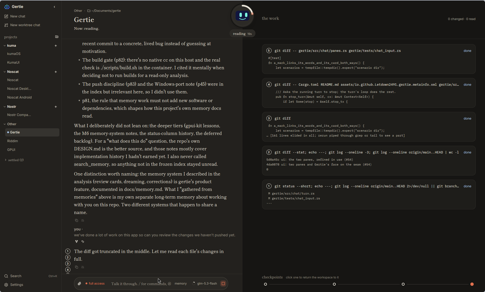

# Gertie

A fast, native coding-agent harness. GPU-rendered UI, a headless core that is a plain
library, and everything local: sessions in SQLite, zero telemetry, no accounts.

<p align="center">
  
</p>

```
gertie-core       headless agent core: loop, sessions, permissions, checkpoints
gertie-providers  provider adapters (OpenAI-compatible + native Anthropic wire)
gertie-tools      built-in tools, sandbox, skills, MCP client
gertie            the desktop app (gpui) + `gertie run` headless shell
```

## Why

Most agent harnesses are either Electron apps or CLI wrappers glued to a cloud. Gertie is
a native Linux desktop app with the same engine available headlessly: one core, two
fronts, nothing shared over the network.

- **Local-first**: sessions persist in SQLite with full-text search over every message
  ever recorded. Every turn is checkpointed (git-style snapshots) before file-mutating
  tools run.
- **Permission broker**: reads are auto-approved; writes and shell commands prompt, with
  the diff shown before you decide. Opt-in [Landlock](https://landlock.io) sandboxing
  isolates bash children (system read-only, writes limited to the workspace and /tmp).
- **Subagents, not a monolith**: eight built-in agent types (explore, plan, implement,
  test, debug, review, research, librarian) dispatched by the leader; define your own in
  TOML, pinned to any configured endpoint: a council of three models can review one diff
  (the bundled `council` skill runs the loop). Workers never spawn workers. They read
  memory but never write it, and a worker that edits runs the project's check before
  it reports.
- **Projects**: named groups for organizing conversations (not folders). File a chat
  under one from its row's move button, or start it from the project's +; a chat is in
  one project at most, and ones you haven't filed sit in Other. Leaving is one click on
  the row too. Each group folds, removing a project only takes it off the list, and
  Ctrl+K finds projects by name.
- **Any model, made sharper**: the harness carries what weaker models miss. A ranked map
  of the repo's code (tree-sitter) sends the model to the right file first; memory
  entries citing a file arrive when the model touches it; when a turn edited files, the
  project check runs before the turn can end; bash output is shaped and re-read files
  collapse, so tokens go to new information; compaction starts at 160k tokens whatever
  the window claims. `gertie eval memory` and `gertie eval nav` score each configured
  model and suggest per-model settings (`memory_writes`, `tool_guidance`). The agent
  can look at its work: `screenshot` renders a page or captures a window, and
  `read_file` on an image shows the picture.
- **Parallel and worktree chats**: a running turn keeps going while you open another
  conversation from the rail or the sidebar, which mark it running or finished. New worktree chat
  starts a chat in its own `git worktree`, so two agents can edit the
  same repo without colliding. Stop ends a running turn and cancels the model's
  request, so a stopped reply stops costing output tokens.
- **Two panes, one face**: paper for words, ink for work. Gertie's reasoning reads in
  a serif on the left, numbered where it caused work; the work it caused (edit cards
  with their diffs, checks with their counts, the checkpoints) sits on the right under
  a one-sentence summary. Gertie's face sits on the seam and shows where the turn is:
  curious, focused, checking, waiting on you, settled, stuck. Memory it relied on
  shows as a seal note, and what it wants to remember is a seal you keep or let go.
- **Any endpoint**: speaks the OpenAI-compatible wire (ppq.ai, OpenRouter, Ollama,
  vLLM, Gemini's compat endpoint) plus a native Anthropic adapter. Fallback chains: when
  an endpoint dies before producing content, the next one takes over invisibly.
- **Editable settings**: a modal over the window with four sections (chat behavior,
  endpoints, memory, tools & agents); each change saves as you make it, through
  `toml_edit`, so your config comments and hand-written keys survive (MCP `args` and
  `env` included). Endpoint changes apply to open chats immediately.
- **MCP**: external tools over stdio *or* Streamable HTTP. Server tool descriptions are
  treated as untrusted input (sanitized, capped); every MCP call prompts.
- **Token ledger**: per-session and all-time token totals, persisted locally. No
  prices-per-model by design; they rot, tokens don't.

## Install

**Release binary (Linux x64, Wayland or X11):** grab `gertie` from the
[latest release](https://github.com/Letdown2491/gertie/releases/latest), put it on
your PATH, and you need the client libraries it links (on Debian/Ubuntu:
`libfontconfig-dev libfreetype-dev libxkbcommon-dev libxkbcommon-x11-dev
libwayland-dev libxcb1-dev libvulkan-dev`).

**From source** (Rust 1.97+, Linux on Wayland or X11 with GPU rendering):

```sh
git clone https://github.com/Letdown2491/gertie.git
cd gertie
cargo install --locked --path gertie   # installs the `gertie` binary
```

(The maintainers build and test inside a pinned container via `./scripts/build.sh`; a
plain `cargo build` works too: `gertie` needs the usual Wayland/X11 client libraries.
`scripts/install-user.sh` installs a container build into `~/.local` with its desktop
entry and icon: the release binary by default, `--debug` for the debug one.)

Releases are cut by pushing a `v*` tag: CI builds the Linux binary, smoke-checks it,
and attaches it to the release with generated notes. `gertie doctor --check-updates`
compares your installed version against the newest tag.

## Quick start

```sh
gertie doctor          # checks config, endpoint, and key resolution; exit 0 = ready
gertie                 # the desktop app
gertie run "fix the flaky test in ci and explain why"   # one headless turn
gertie eval memory     # scores each configured model on using memory (live calls)
gertie eval nav        # measures what the repo map saves each model in finding code
```

First launch writes a starter `~/.config/gertie/config.toml` with comments and pointers
only: no endpoint is built in, so none is invented for you. Add yours in the app
(settings, Endpoints) or by hand:

```toml
[[endpoints]]
name = "mine"
base_url = "https://your-provider.example/v1"   # any OpenAI-compatible server
model = "the-model-id"                          # the id your endpoint serves
api_key_env = "MY_API_KEY"
```

Keys resolve from the environment first (`MY_API_KEY` above); a local server needs
no key at all.

**Memory and instructions**: Gertie remembers across sessions. Facts it proposes at
session end land as review cards you approve or deny; rules that must always apply go
in `AGENTS.md` at the repo root (or `~/.config/gertie/AGENTS.md` for global ones). An
`AGENTS.md` in a subdirectory scopes its rules to that part of the tree: Gertie loads it
the first time it reads or edits a file under it. All are plain markdown you can edit by
hand. [docs/memory.md](docs/memory.md)
explains the whole system, including the weekly cleanup pass ("dreaming").

`config.example.toml` documents everything else: wire selection (`openai` |
`anthropic`), fallback endpoints, MCP servers, custom agents, search backends,
sandboxing. `gertie run` prompts for approval of mutating tool calls; pipe-safe mode
denies them unless `--yes` is given, and `--yes` refuses uncommitted work unless
`--allow-dirty` is given too. [docs/TOUR.md](docs/TOUR.md) is the guided
version of this whole list.

## Security posture

- Zero telemetry. Outbound traffic: the endpoints you configure, the search backend,
  and `web_fetch` to model-chosen hosts (each fetch prompts with its URL; the update
  check is opt-in).
- API keys resolve from the environment (`api_key_env`), never required in the config
  file; a literal key is allowed but flagged in the status line.
- Tool calls: reads auto-approved; `web_fetch` shows a card with its URL before it
  dials; writes and bash prompt with a diff; bash can be Landlock-sandboxed at the
  kernel level (opt-in). `screenshot` asks before capturing; the auto mode runs a
  capture of a project page or a localhost dev server unasked, never a window, the
  screen, or a remote page.
- MCP tools are third-party code: descriptions are sanitized untrusted input and every
  call prompts: the user is the capability system.
- Long-term memory is advisory and auditable: plain markdown files you can read and
  edit, every entry traced to its source session, nothing enters memory without your
  approval by default. See [docs/memory.md](docs/memory.md).

## Status

**1.3.0**: the status column — the open session's working state beside the transcript
(WORKING ON, NEXT UP, REMEMBERED, TOUCHED, DEPENDS ON, asks, corrections) with a riding
grounding line on the latest turn — plus the memory trust arc: superseded entries ride
search results pointing at their replacement, the tool path shapes the store exactly like
the ops path, recall fires on touch, and the repo map gives navigation a ranked view of
the workspace. Feature-complete against [DESIGN.md](DESIGN.md) (see "The original 'Deferred'
row" for every decision and its rationale). New to the tool? [The tour](docs/TOUR.md)
walks the whole surface in ten minutes.

## License

MIT. See [LICENSE](LICENSE).
